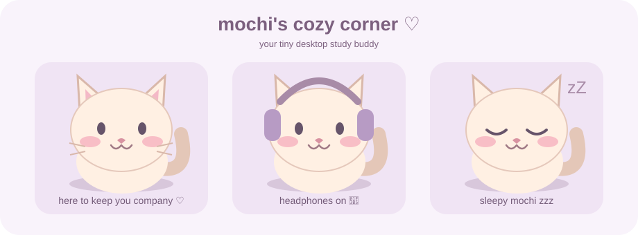

# Mochi's Cozy Corner 🐈

A tiny, animated **floating desktop cat for Windows**, built with **Tauri 2, React, TypeScript, and Rust**. Mochi keeps you company while you study, naps when you're away, and wears headphones when compatible Bluetooth headphones are connected.



*Meet Mochi: your cozy companion, with headphones and sleepy-time moods. Illustration based on the app's SVG cat artwork.*

## ✨ Features

- Compact, transparent desktop companion that docks near the bottom-right corner
- Pet Mochi to see hearts and a happy expression
- Automatically falls asleep after 60 seconds of Windows inactivity
- Automatically shows headphones when compatible Bluetooth headsets are connected (with a manual override)
- Expandable Pomodoro timer: 25-minute focus and 5-minute break sessions
- Clock, draggable window, and always-on-top toggle

## 🐱 Install Mochi on Windows (no coding required)

**For anyone who just wants to use the app:**

1. Visit the [GitHub Releases page](https://github.com/RianaMalhotra/Mochi-s-Cozy-Corner/releases).
2. Open the latest release and expand **Assets**.
3. Download the Windows **`.msi` installer** (for example, a file ending in `_x64_en-US.msi`).
4. Double-click the downloaded file and follow the Windows installation wizard.
5. Find **Mochi's Cozy Corner** in the Windows **Start menu** and open it.

**That's it!** You do **not** need to install Node.js, Rust, Git, VS Code, or run any terminal commands to use the installed app.

> **Note:** The Releases page only offers a download once the maintainer has published a release and attached the MSI installer. If no MSI is listed, there is not yet a public installer to download. Windows may display a SmartScreen warning for an unsigned installer; verify the download came from this repository before deciding whether to proceed. The Microsoft Edge WebView2 runtime is required and is usually already installed on current Windows systems.

### Start Mochi automatically when you sign in (optional)

1. Press **Win + R**, type `shell:startup`, and press Enter.
2. Open the Start menu, locate Mochi, and create a shortcut to the installed app.
3. Put that shortcut in the Startup folder.

Mochi will launch when you sign in to Windows. Remove the shortcut to disable automatic startup.

## 🖥️ System tray

The desktop app includes a Windows notification-area icon. Right-click it for **Show Mochi**, **Hide Mochi**, and **Quit Mochi**. Left-click to show the pet again. This is especially useful because Mochi does not have a taskbar button.

## 🔐 Signed automatic updates (maintainer setup)

Mochi checks for signed updates on startup and **asks before downloading or installing**. This requires one-time release signing setup before it can work. The published v0.1.0 installer does not have an updater; install the first updater-enabled version manually once.

### 1. Generate the key pair locally

From a trusted local terminal, run:

```powershell
npm install
npm run tauri signer generate -- -w "$env:USERPROFILE\.tauri\mochi.key"
```

Keep the generated **private key** and password secret. Never commit them, paste them into an issue, or share them. Back them up securely. If the key is lost, existing installations cannot trust future updates signed with a replacement key.

### 2. Configure the repository

- Copy the generated **public key** (not private key) into `src-tauri/tauri.conf.json`, replacing `REPLACE_WITH_TAURI_UPDATER_PUBLIC_KEY`.
- In GitHub repository **Settings → Secrets and variables → Actions**, create `TAURI_SIGNING_PRIVATE_KEY` containing the **private key file contents**, and `TAURI_SIGNING_PRIVATE_KEY_PASSWORD` containing the password.
- Commit only the public key change to `main`. Never commit private key files or passwords.

### 3. Publish a versioned update

- Update `version` in `src-tauri/tauri.conf.json`, `src-tauri/Cargo.toml`, and `package.json` to the same new version, for example `0.2.0`.
- Commit and push. Create and push a matching tag: `git tag v0.2.0` then `git push origin v0.2.0`.
- The GitHub Actions **Release Mochi (signed Windows updater)** workflow builds the Windows MSI and signed updater files and creates a **draft release**.
- Inspect the release and its `latest.json` and signed update assets, then **publish** the draft. Draft releases are not discoverable by the updater.
- Manually install this first updater-enabled MSI once. Future published releases will be checked at startup and require the user's approval before installation.

**Important:** A push to `main` alone does not publish an update. The installed application must have the correct public key, and each release must include valid signed updater artifacts. Windows may request installer elevation depending on installation context.

## 🛠️ Development (contributors)

Developers building Mochi from source on Windows need:

- Node.js 20+ and npm
- Rust with the MSVC toolchain
- Visual Studio C++ Build Tools and Windows SDK
- Microsoft Edge WebView2

See the [official Tauri 2 Windows prerequisites](https://v2.tauri.app/start/prerequisites/).

```powershell
git clone https://github.com/RianaMalhotra/Mochi-s-Cozy-Corner.git
cd Mochi-s-Cozy-Corner
npm install
npm run tauri dev
```

For a browser-only UI preview (native window and Windows Bluetooth/idle detection are unavailable):

```powershell
npm run dev
```

Open http://127.0.0.1:1420.

## 📦 Build and publish a Windows installer (maintainers)

From a working Windows development environment:

```powershell
npm install
npm run tauri build
```

After a successful build, the MSI installer is in:

```text
src-tauri/target/release/bundle/msi/
```

To make Mochi installable by other people:

1. Go to the repository's [Releases page](https://github.com/RianaMalhotra/Mochi-s-Cozy-Corner/releases) and choose **Draft a new release**.
2. Create a version tag, such as `v0.1.0`, and add release notes.
3. Drag the generated **`.msi` file** into the release's **Assets** area.
4. Publish the release.
5. Test the public download link on another Windows PC.

**Do not upload just the source-code ZIP:** users need the compiled MSI installer. Build again and publish a new installer when you want to distribute updated app code.

## Limitations

- Mochi is a floating window, not a cat that walks independently across other windows.
- The Pomodoro timer does not keep running as a background service after the app closes.
- Bluetooth headphone detection currently targets certain Windows Bluetooth headset/headphone device classes; some earbuds may not be recognized.
- Windows native features are unavailable in the browser preview.
- The artwork is hand-written SVG and CSS; no external cat image is required.
